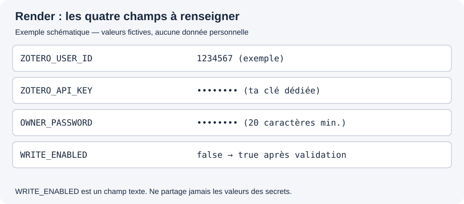
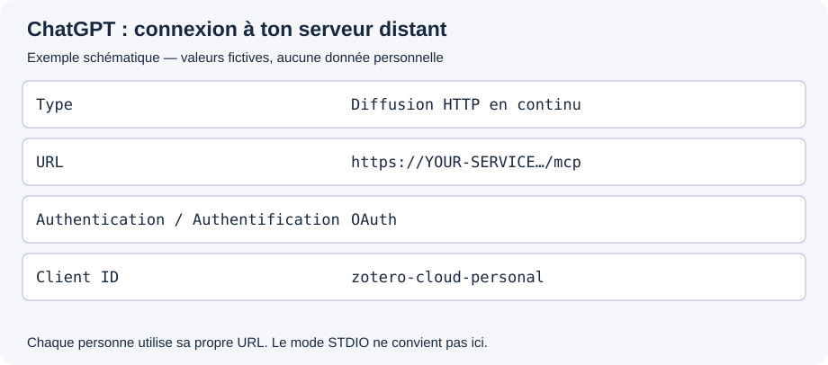

[Français](README.fr.md) · [English](README.md)

<a id="overview"></a>

# Zotero Cloud ↔ ChatGPT

**Retrouver, classer et enrichir ses références Zotero depuis une conversation ChatGPT, même quand son ordinateur est éteint.**

Ce connecteur s’adresse notamment aux chercheurs qui travaillent en déplacement, sur plusieurs appareils ou par dictée vocale. Il utilise ta bibliothèque synchronisée sur Zotero Cloud ; Zotero Desktop n’a pas besoin d’être ouvert. Quand tu réutiliseras Zotero Desktop, les modifications seront récupérées par sa synchronisation habituelle.

> **État : version candidate pour une bêta ouverte.** Une installation personnelle a été validée en lecture et en écriture par son utilisateur. Cette préparation vise des volontaires recrutés ouvertement, notamment sur Reddit. Chaque testeur utilise son serveur et son autorisation Zotero. Cette distribution communautaire est préparée séparément du dépôt de développement privé d’origine, avec un historique Git neuf. Une fois publiée, elle sera lisible sans invitation ni permission d’écriture. Voir [le protocole de bêta ouverte](docs/open-beta.fr.md).

**Accès rapide :** [Installation](#installation) · [Dépannage](#troubleshooting) · [Données et accès](#data-access) · [Partie technique](#development)

<a id="examples"></a>

## Ce que tu peux lui demander

- « Quelles références de cette autrice figurent déjà dans ma bibliothèque ? »
- « Cherche cet article avant de l’ajouter ; s’il existe, complète seulement les informations manquantes. »
- « Ajoute ces tags sans retirer ceux que j’ai déjà. »
- « Classe cette référence dans ma collection existante. »
- « À partir de cette transcription, ajoute une note expliquant qui m’a recommandé ce texte et pourquoi. »

Le connecteur recherche les doublons probables et bloque les créations ambiguës. Il ne doit pas inventer un ouvrage à partir d’une simple mention d’auteur. **Aucun outil de suppression n’est proposé.**

<a id="how-it-works"></a>

## Comment cela fonctionne, en une minute

Un petit programme hébergé sur Internet fait le lien entre ChatGPT et Zotero. Ce programme est ton **serveur personnel**. Render est le service proposé ici pour l’héberger avec une adresse HTTPS sécurisée.

Chaque personne installe son exemplaire et utilise sa propre clé Zotero. Le serveur du développeur n’est pas utilisé pour consulter ta bibliothèque. Le code du projet ne reçoit aucune clé automatiquement : tu renseignes la tienne directement chez ton hébergeur.

**Tu n’as pas à programmer ni à utiliser un terminal pour l’installation de base.** Il reste néanmoins quelques opérations dans Zotero, Render et ChatGPT. Le guide les présente dans l’ordre.

<a id="requirements"></a>

## Avant de commencer

Il te faut :

- un compte **Zotero**, avec ta bibliothèque synchronisée en ligne ;
- un compte **ChatGPT** dont l’interface permet d’ajouter un serveur MCP personnalisé ;
- un compte **Render**, pour héberger ton exemplaire ;
- ton gestionnaire de mots de passe, pour conserver les deux secrets créés pendant l’installation.

Render peut demander une connexion à GitHub pour accéder au dépôt. Copier le dépôt dans ton propre compte GitHub — faire un « fork » — est possible, mais n’est pas indispensable au déploiement d’un dépôt public via le bouton ci-dessous.

La disponibilité des connexions MCP peut varier selon le compte et l’application ChatGPT. Si l’option est absente, arrête-toi à cette vérification et signale-le : le projet ne demande pas de souscrire une offre payante pour poursuivre le guide. Commence dans l’interface ChatGPT qui propose cette fonction ; tu vérifieras ensuite ton application mobile habituelle.

### Deux limites à connaître dès maintenant

**Render gratuit se met en veille après 15 minutes sans activité.** Il se réveille au prochain appel ; le premier résultat peut prendre une minute ou davantage. Ce n’est pas une limite de 15 minutes d’utilisation.

**Une reconnexion à ChatGPT peut être nécessaire après 8 heures.** Le renouvellement automatique des autorisations n’est pas encore implémenté. Une fenêtre de connexion ouverte reste valable 15 minutes ; un redémarrage du serveur peut l’invalider.

<a id="installation"></a>

## Installer le connecteur

[](https://render.com/deploy?repo=https%3A%2F%2Fgithub.com%2Fpapoututu%2FChatGPTtoZotero_community)

**Ce bouton cible la branche de bêta préparée**, plutôt que la branche de déploiement personnel du propriétaire. Les autres personnes pourront l’utiliser une fois le dépôt public. Les modifications du code ne sont pas déployées automatiquement sur leurs instances. Voir [les vérifications de publication](docs/publication.fr.md) avant d’annoncer le lien.

### Étape 1 — Donner à ton serveur une autorisation Zotero

Ouvre [la page des clés Zotero](https://www.zotero.org/settings/keys).

1. Repère **User ID** : c’est un **nombre**, pas ton nom d’utilisateur. Garde-le pour l’étape 2.
2. Clique **Create new private key** et donne à cette clé un nom reconnaissable, par exemple `ChatGPT Zotero Cloud`.
3. Autorise l’accès à ta bibliothèque personnelle, aux notes et à l’écriture. L’accès aux groupes n’est pas nécessaire.
4. Enregistre la nouvelle clé dans ton gestionnaire de mots de passe. Elle sera à copier directement dans Render.

Une **clé API** est une autorisation d’accès propre à une application. Tu peux révoquer celle-ci plus tard dans Zotero sans changer ton mot de passe Zotero.

**Résultat attendu :** tu disposes de ton identifiant numérique et d’une clé dédiée. Ne saisis jamais cette clé dans une conversation ChatGPT ni dans un ticket d’aide.

### Étape 2 — Créer ton serveur sur Render

Clique sur **Déployer sur Render** ci-dessus, connecte-toi à Render et autorise l’accès au dépôt si demandé. Le fichier de configuration remplit déjà les commandes et les réglages techniques.

Vérifie que le service est un **Web Service** sur le plan **Free**. Aucun service payant n’est déclaré par notre configuration. Ne choisis pas une offre payante pour terminer ce test.

Renseigne les quatre champs suivants :

| Nom affiché dans Render | Ce que tu dois saisir                                                                                                              |
| ----------------------- | ---------------------------------------------------------------------------------------------------------------------------------- |
| `ZOTERO_USER_ID`        | Le nombre indiqué près de **User ID** dans Zotero.                                                                                 |
| `ZOTERO_API_KEY`        | La clé dédiée que tu viens de créer.                                                                                               |
| `OWNER_PASSWORD`        | Un **nouveau mot de passe d’au moins 20 caractères**, réservé à ce connecteur. Conserve-le dans ton gestionnaire de mots de passe. |
| `WRITE_ENABLED`         | Le texte **`false`** pour commencer en lecture seule.                                                                              |



**Ces cases sont des champs texte, pas des menus déroulants.** Render peut masquer leur contenu, même pour `true` et `false`. Saisis les valeurs sans ajouter de guillemets.

Le secret de signature est généré automatiquement ; l’adresse du serveur est détectée automatiquement sur Render. Les paramètres OAuth publics ont déjà une valeur par défaut dans le programme. Tu n’as pas à les inventer.

Clique **Deploy Blueprint**, puis attends le statut **Live**.

- **Build successful** signifie que le programme a été construit.
- **Live** signifie que le serveur est démarré.
- En cas d’échec, les dernières lignes des **Logs** indiquent le paramètre à corriger. Tu peux le modifier dans **Environment → Edit**, puis enregistrer et redéployer.

**Résultat attendu :** le service est **Live** et Render affiche une adresse du type `https://ton-service.onrender.com`. Cette adresse est un exemple : utilise toujours la tienne.

### Étape 3 — Relier ChatGPT à ton serveur

Ouvre [la page Plugins de ChatGPT](https://chatgpt.com/plugins).

Dans **Ajouter**, cherche l’ajout d’un **MCP personnalisé**. MCP est simplement le protocole qui permet à ChatGPT d’appeler les fonctions du serveur. Les libellés exacts peuvent varier entre les applications.

Remplis le formulaire :

| Champ                         | Valeur                                                                                       |
| ----------------------------- | -------------------------------------------------------------------------------------------- |
| Nom                           | `Zotero Cloud — connexion`                                                                   |
| Type                          | **Diffusion HTTP en continu** — et non STDIO, réservé à un autre mode d’installation.        |
| URL                           | **Ton adresse Render suivie de `/mcp`**, par exemple `https://ton-service.onrender.com/mcp`. |
| Authentification, si demandée | **OAuth**.                                                                                   |
| Client ID, si demandé         | `zotero-cloud-personal`                                                                      |
| Client secret                 | Laisser vide : ce connecteur utilise un client public.                                       |



Enregistre puis lance **Connecter**. Une page intitulée **« Autoriser votre connecteur personnel »** s’ouvre sur ton domaine Render.

Saisis le mot de passe que tu as choisi pour **`OWNER_PASSWORD`**, puis clique une seule fois sur **Autoriser ChatGPT**. Ce n’est ni ton mot de passe Zotero, ni la clé API. Le navigateur doit te ramener dans ChatGPT.

**Résultat attendu :** la connexion est indiquée comme connectée. Si une fenêtre échoue, ferme-la et relance une nouvelle connexion depuis ChatGPT ; ne réutilise pas une ancienne demande. Si une demande neuve échoue aussi, consulte [le dépannage](docs/troubleshooting.fr.md) plutôt que de répéter les clics.

### Étape 4 — Vérifier la lecture avant toute modification

Ouvre une **nouvelle conversation** et sélectionne ta connexion avec `@`. Demande :

> Liste trois de mes collections Zotero existantes avec leurs identifiants, sans rien modifier.

Puis demande une référence que tu connais déjà, par son DOI ou son titre. Compare les résultats avec Zotero Web.

**Résultat attendu :** les outils interrogent réellement ta bibliothèque. Une réponse générale sur un auteur, sans appel d’outil ni données de ta bibliothèque, ne suffit pas à valider l’installation.

Si la connexion MCP fonctionne, tu disposes déjà des huit outils. Il n’est pas nécessaire de créer un second serveur ou un autre plugin pour commencer.

### Étape 5 — Autoriser et vérifier une seule écriture

Après une lecture réussie, retourne dans Render :

1. Ouvre **ton service → Environment → Edit**.
2. Sur la ligne **`WRITE_ENABLED`**, remplace `false` par **`true`**, sans guillemets.
3. Choisis **Save and deploy** et attends **Live**.

Dans ChatGPT, choisis une référence existante que tu connais et demande :

> Retrouve la notice portant le DOI [le DOI d’une référence unique de ma bibliothèque]. Si elle est unique, propose une courte note de validation. Après mon accord, ajoute cette seule note enfant, puis relis les notes pour confirmer un ajout unique. Ne modifie rien d’autre.

Remplace le texte entre crochets par un vrai DOI que tu possèdes. Ne crée pas une fausse référence pour le test : aucun outil de suppression n’est disponible pour la retirer ensuite. La note de validation restera dans ta bibliothèque.

**Résultat attendu :** une seule note est retrouvée, les autres informations sont inchangées. Tu peux remettre `WRITE_ENABLED=false` si tu souhaites revenir en lecture seule.

<a id="using-it"></a>

## L’installation est terminée : que faire ensuite ?

Tu peux travailler en langage naturel avec ta connexion. Quelques habitudes utiles :

- fournir la source quand tu demandes une note expliquant une recommandation ;
- demander une recherche avant toute création ;
- distinguer les éditions, traductions, chapitres et articles malgré des titres proches ;
- laisser une référence incertaine en attente plutôt que l’inventer ;
- vérifier les résultats des premières opérations dans Zotero Web.

Un modèle de **workflow bibliographique** est fourni pour conserver ces consignes dans un plugin personnel. C’est une étape facultative : la connexion MCP fournit déjà les outils. L’association doit utiliser **ton identifiant d’application ChatGPT**, jamais celui d’une autre installation. Le [guide du paquet personnel](docs/personal-plugin.fr.md) explique le parcours avec Plugin Creator et fournit une commande de génération pour les utilisateurs accompagnés techniquement.

Pour la mobilité, refais d’abord une lecture sur ton téléphone ou ta tablette et vérifie que l’application permet de sélectionner ta connexion. Le fonctionnement sur un appareil ne prouve pas sa disponibilité sur tous les autres.

<a id="troubleshooting"></a>

## Les blocages les plus fréquents

| Ce que tu vois                                | Où regarder en premier                                                                                              |
| --------------------------------------------- | ------------------------------------------------------------------------------------------------------------------- |
| Build réussi mais serveur arrêté              | Logs Render : chercher le nom du paramètre incomplet.                                                               |
| Le mot de passe est refusé                    | Utiliser `OWNER_PASSWORD`, pas la clé API ni le mot de passe Zotero. Le nouvel écran distingue les causes du refus. |
| Demande expirée ou déjà utilisée              | Fermer la fenêtre et relancer la connexion dans ChatGPT.                                                            |
| Réponse bibliographique mais aucun accès réel | Vérifier le MCP dans une nouvelle conversation, pas seulement les instructions du plugin.                           |
| `WRITES_DISABLED`                             | Vérifier `WRITE_ENABLED=true` et attendre le redéploiement.                                                         |
| `PROBABLE_DUPLICATE`                          | Examiner les candidats existants ; ne pas créer une variante artificielle pour contourner le blocage.               |
| `VERSION_CONFLICT`                            | Relire la notice avant de recommencer la modification.                                                              |
| Premier appel lent                            | Attendre le réveil du service Render gratuit.                                                                       |

Le [guide de dépannage](docs/troubleshooting.fr.md) détaille les erreurs. Pour un retour de test, indique l’étape du guide, l’application utilisée et le message exact, **sans clé, mot de passe, transcription confidentielle ou URL complète de consentement**. Un [modèle de ticket](.github/ISSUE_TEMPLATE/retour-testeur.md) est prévu.

<a id="data-access"></a>

## Données, limites et retrait de l’accès

Le serveur personnel traite les réponses de Zotero et les transmet à ChatGPT pour la conversation. Les informations demandées, y compris les notes, passent donc par ton hébergeur et OpenAI. Vérifie que cela convient au caractère confidentiel de tes recherches. Le code ne journalise pas les clés, mots de passe ou notices. [Description des flux de données](docs/privacy.fr.md).

La clé Zotero avec écriture possède des droits plus larges que les outils exposés ici : sa confidentialité reste importante, même si le connecteur ne propose aucune suppression.

Pour interrompre l’accès à ta bibliothèque, **révoque la clé dédiée dans Zotero**. Déconnecter le MCP dans ChatGPT et arrêter le serveur dans Render sont deux actions distinctes. Changer le mot de passe du connecteur ne révoque pas les tokens déjà émis ; changer `AUTH_SIGNING_SECRET` les invalide.

Cette version traite une bibliothèque personnelle par serveur. Elle ne prend pas en charge les groupes, les pièces jointes, la création de collections, le remplacement des notes ou la suppression. Une lecture complète précède les créations ; les grandes bibliothèques peuvent être lentes et les doublons ambigus sont bloqués sans fusion automatique.

<a id="development"></a>

## Pour les personnes qui maintiennent ou adaptent le code

Cette partie est facultative. Les premiers utilisateurs peuvent suivre uniquement les étapes d’installation ci-dessus.

Node.js 24 ; TypeScript ; SDK MCP officiel v2 ; HTTP natif ; Zod et jose. Les versions installées sont fixées par `package-lock.json`. Les tests utilisent des mocks et ne modifient aucune bibliothèque réelle.

```sh
npm ci && npm run check && npm test
```

`npm run setup` prépare un `.env` local avec saisie masquée des secrets ; `npm start` lance le serveur. Voir [.env.example](.env.example) et [le détail des paramètres](docs/parameters.fr.md).

Diagnostic public facultatif, sans clé ni accès à Zotero :

```sh
npm run doctor -- --url https://YOUR-SERVICE.onrender.com
```

Génération facultative d’un paquet personnel, après création du MCP dans ChatGPT :

```sh
npm run package:plugin -- --url https://YOUR-SERVICE.onrender.com --app-id asdk_app_YOUR_VERIFIED_ID --archive
```

Remplace les deux exemples par tes propres valeurs. L’option `--archive` utilise la commande système `tar`. Le script refuse d’écraser un dossier déjà présent. L’import du paquet est distinct de sa génération et d’une publication dans le répertoire ChatGPT.

Les nouvelles installations communautaires ne se mettent pas à jour automatiquement à chaque commit du projet. Consulte les changements puis lance une mise à jour manuelle dans Render quand tu le souhaites. Les paramètres personnels, dont `WRITE_ENABLED`, sont déclarés `sync: false` pour ne pas être réimposés par le Blueprint.

Documents utiles : [architecture](docs/architecture.fr.md), [premiers testeurs](docs/first-testers.fr.md), [préparation de la diffusion](docs/publication.fr.md), [signalement de sécurité](SECURITY.fr.md).

<a id="license"></a>

## Licence et contribution

Projet indépendant proposé par Johann Chaulet sous [licence MIT](LICENSE). La réutilisation et la modification sont autorisées dans les conditions de cette licence, en conservant la notice d’attribution.

Le code publié et les modèles permettront une installation personnelle. Un service commun pour plusieurs utilisateurs ou une publication dans le répertoire officiel ChatGPT sont des étapes distinctes ; ils ne sont pas réalisés par ce dépôt en préparation.
