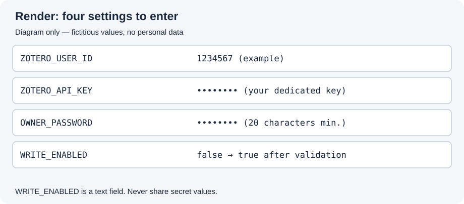
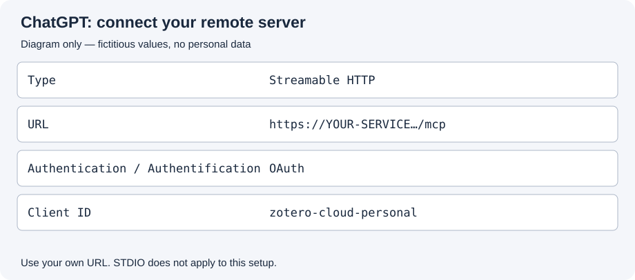

[English](README.md) · [Français](README.fr.md)

<a id="overview"></a>

# Zotero Cloud ↔ ChatGPT

**Find, organize and enrich your Zotero references from a ChatGPT conversation, even when your computer is switched off.**

This connector is intended especially for researchers working on the move, across devices or with voice dictation. It uses your library synced to Zotero Cloud; Zotero Desktop does not need to be running. When you next use Zotero Desktop, its usual synchronization will retrieve the changes.

> **Status: open-beta candidate.** One personal installation has been validated for reading and writing by its user. This preparation is intended for volunteers recruited openly, including on Reddit. Each tester uses their own server and Zotero authorization. This community distribution is prepared separately from the original private development repository, with a fresh Git history. No invitation or write permission is needed to read it once published. See [the open-beta protocol](docs/open-beta.md).

**Quick links:** [Installation](#installation) · [Troubleshooting](#troubleshooting) · [Data and access](#data-access) · [Technical details](#development)

<a id="examples"></a>

## What you can ask it

- “Which references by this author are already in my library?”
- “Look for this article before adding it; if it exists, only fill in missing information.”
- “Add these tags without removing my existing ones.”
- “File this reference in my existing collection.”
- “Using this transcript, add a note explaining who recommended this text to me and why.”

The connector checks for likely duplicates and blocks ambiguous creations. It should not invent a specific work from an author's name alone. **No deletion tools are provided.**

<a id="how-it-works"></a>

## How it works in one minute

A small program hosted online connects ChatGPT to Zotero. This program is your **personal server**. This guide uses Render to host it at a secure HTTPS address.

Each person installs their own instance and uses their own Zotero key. The developer's server is not used to access your library. The project code does not receive any key automatically: you enter yours directly in your hosting account.

**No programming or terminal is required for the basic installation.** You still need to complete a few steps in Zotero, Render and ChatGPT. This guide presents them in order.

<a id="requirements"></a>

## Before you begin

You will need:

- a **Zotero** account with your library synced online;
- a **ChatGPT** account whose interface allows adding a custom MCP server;
- a **Render** account to host your instance;
- your password manager to keep the two secrets created during setup.

Render may ask you to connect GitHub to access the repository. Copying the repository to your own GitHub account—a “fork”—is an option, but is not essential when deploying a public repository through the button below.

MCP connections may be available in some ChatGPT accounts or applications and unavailable in others. If the option is missing, stop at this check and report it: this project does not ask you to subscribe to a paid plan to continue the guide. Start in a ChatGPT interface that offers the feature; test your usual mobile app afterwards.

### Two limitations to know upfront

**Render's free service sleeps after 15 minutes without activity.** It wakes up on the next request; the first response can take a minute or longer. This is not a 15-minute usage limit.

**You may need to reconnect to ChatGPT after 8 hours.** Automatic authorization renewal is not implemented yet. An open sign-in request remains valid for 15 minutes; restarting the server can invalidate it.

<a id="installation"></a>

## Install the connector

[](https://render.com/deploy?repo=https%3A%2F%2Fgithub.com%2Fpapoututu%2FChatGPTtoZotero_community)

**This button targets the standalone community repository**, once published. It does not use the original private development repository. Code pushes do not automatically deploy to their instances. See [publication checks](docs/publication.md) before announcing the link.

### Step 1 — Authorize your server in Zotero

Open [the Zotero keys page](https://www.zotero.org/settings/keys).

1. Find **User ID**: it is a **number**, not your username. Keep it for step 2.
2. Click **Create new private key** and give it a recognizable name, such as `ChatGPT Zotero Cloud`.
3. Allow access to your personal library, notes and writing. Group access is not required.
4. Save the new key in your password manager. You will paste it directly into Render.

An **API key** is an application's own access authorization. You can revoke this one later in Zotero without changing your Zotero password.

**Expected result:** you have your numeric user ID and a dedicated key. Never enter this key in a ChatGPT conversation or a support issue.

### Step 2 — Create your server on Render

Click **Deploy to Render** above, sign in to Render and authorize repository access if prompted. The configuration file already supplies the commands and technical settings.

Check that the service is a **Web Service** using the **Free** plan. Our configuration does not declare any paid service. Do not choose a paid plan to complete this test.

Fill in these four fields:

| Name shown in Render | What to enter |
|---|---|
| `ZOTERO_USER_ID` | The number shown next to **User ID** in Zotero. |
| `ZOTERO_API_KEY` | The dedicated key you just created. |
| `OWNER_PASSWORD` | A **new password of at least 20 characters**, used only for this connector. Keep it in your password manager. |
| `WRITE_ENABLED` | The text **`false`** to start in read-only mode. |



**These are text fields, not dropdown menus.** Render may mask their contents, even for `true` and `false`. Enter values without surrounding quotation marks.

The signing secret is generated automatically, and the server detects its Render address automatically. Public OAuth parameters already have defaults in the program. You do not need to invent them.

Click **Deploy Blueprint**, then wait for the **Live** status.

- **Build successful** means the program has been built.
- **Live** means the server has started.
- If it fails, the final **Logs** lines identify the setting to correct. Change it under **Environment → Edit**, then save and redeploy.

**Expected result:** the service is **Live**, and Render displays an address such as `https://YOUR-SERVICE.onrender.com`. This is an example: always use your own address.

### Step 3 — Connect ChatGPT to your server

Open [ChatGPT's Plugins page](https://chatgpt.com/plugins).

Under **Add**, look for adding a **custom MCP**. MCP is simply the protocol ChatGPT uses to call the server's functions. Exact labels may differ between applications.

Complete the form:

| Field | Value |
|---|---|
| Name | `Zotero Cloud — connection` |
| Type | **Streamable HTTP**, not STDIO, which is used for a different installation method. |
| URL | **Your Render address followed by `/mcp`**, for example `https://YOUR-SERVICE.onrender.com/mcp`. |
| Authentication, if requested | **OAuth**. |
| Client ID, if requested | `zotero-cloud-personal` |
| Client secret | Leave empty: this connector uses a public client. |



Save, then choose **Connect**. A page titled **“Autoriser votre connecteur personnel”** (“Authorize your personal connector”) opens on your Render domain.

Enter the password you chose for **`OWNER_PASSWORD`**, then click **“Autoriser ChatGPT”** (“Authorize ChatGPT”) once. This is neither your Zotero password nor your API key. The browser should return to ChatGPT.

**Expected result:** the connection is shown as connected. If a window fails, close it and start a new connection from ChatGPT; do not reuse an old request. If a fresh request also fails, use [troubleshooting](docs/troubleshooting.md) rather than clicking repeatedly.

### Step 4 — Check reading before making any changes

Open a **new conversation** and select your connection with `@`. Ask:

> List three of my existing Zotero collections with their identifiers, without changing anything.

Then ask for a reference you already know by its DOI or title. Compare the results with Zotero Web.

**Expected result:** the tools actually query your library. A general answer about an author, without a tool call or data from your library, is not enough to validate the installation.

Once the MCP connection works, all eight tools are available. You do not need to create a second server or another plugin to get started.

### Step 5 — Allow and check one write operation

After a successful read, return to Render:

1. Open **your service → Environment → Edit**.
2. In the **`WRITE_ENABLED`** row, replace `false` with **`true`**, without quotation marks.
3. Choose **Save and deploy**, then wait for **Live**.

In ChatGPT, choose an existing reference you know and ask:

> Find the item with DOI [the DOI of a unique reference in my library]. If it is unique, propose a short validation note. After I agree, add just this child note, then read the notes again to confirm it was added once. Do not change anything else.

Replace the text in brackets with a real DOI you already have. Do not create a fake reference for testing: no deletion tool is available to remove it afterwards. The validation note will remain in your library.

**Expected result:** exactly one note is found, and other information is unchanged. Set `WRITE_ENABLED=false` again if you want to return to read-only mode.

<a id="using-it"></a>

## Setup is complete: what next?

You can use your connection in natural language. Some useful habits:

- provide the source when asking for a note explaining a recommendation;
- request a search before any creation;
- distinguish editions, translations, chapters and articles despite similar titles;
- leave an uncertain reference unresolved rather than inventing it;
- check the results of your first operations in Zotero Web.

A **bibliographic workflow** template is included to keep these instructions in a personal plugin. This step is optional: the MCP connection already provides the tools. The binding must use **your ChatGPT application ID**, never one from another installation. The [personal package guide](docs/personal-plugin.md) explains the Plugin Creator workflow and provides a generation command for users with technical assistance.

For mobile use, first repeat a read on your phone or tablet and check that the app lets you select your connection. Working on one device does not prove availability on every other device.

<a id="troubleshooting"></a>

## Common problems

| What you see | Where to look first |
|---|---|
| Build succeeded, but the server stopped | Render logs: look for the name of an incomplete setting. |
| Password rejected | Use `OWNER_PASSWORD`, not the API key or your Zotero password. The updated screen distinguishes the reasons for a refusal. |
| Request expired or already used | Close the window and restart the connection in ChatGPT. |
| Bibliographic answer, but no real library access | Check the MCP in a new conversation, not just the plugin instructions. |
| `WRITES_DISABLED` | Check `WRITE_ENABLED=true` and wait for redeployment. |
| `PROBABLE_DUPLICATE` | Examine the candidates; do not create an artificial variation to bypass the block. |
| `VERSION_CONFLICT` | Read the item again before retrying the change. |
| Slow first request | Wait for Render's free service to wake up. |

The [troubleshooting guide](docs/troubleshooting.md) explains the errors. For a test report, provide the guide step, application used and exact message, **without a key, password, confidential transcript or complete consent URL**. A [feedback issue template](.github/ISSUE_TEMPLATE/feedback.md) is provided.

<a id="data-access"></a>

## Data, limitations and removing access

Your personal server processes Zotero's responses and sends them to ChatGPT for the conversation. Requested information, including notes, therefore passes through your hosting provider and OpenAI. Check that this suits the confidentiality of your research. The code does not log keys, passwords or library items. [Data flow description](docs/privacy.md).

A Zotero key with write access has broader permissions than the tools exposed here: keeping it confidential remains important even though the connector offers no deletion.

To stop access to your library, **revoke the dedicated key in Zotero**. Disconnecting the MCP in ChatGPT and stopping the server in Render are separate actions. Changing the connector password does not revoke tokens already issued; changing `AUTH_SIGNING_SECRET` invalidates them.

This version handles one personal library per server. It does not support groups, attachments, collection creation, note replacement or deletion. A full read precedes creation; large libraries can be slow, and ambiguous duplicate candidates are blocked without automatic merging.

<a id="development"></a>

## For people maintaining or adapting the code

This section is optional. First-time users can follow only the installation steps above.

Node.js 24; TypeScript; official MCP SDK v2; native HTTP; Zod and jose. Installed versions are pinned by `package-lock.json`. Tests use mocks and do not modify any real library.

```sh
npm ci && npm run check && npm test
```

`npm run setup` creates a local `.env` file with hidden secret entry; `npm start` starts the server. See [.env.example](.env.example) and [the parameter reference](docs/parameters.md).

Optional public diagnostic, requiring no key or Zotero access:

```sh
npm run doctor -- --url https://YOUR-SERVICE.onrender.com
```

Optional personal package generation, after creating the MCP in ChatGPT:

```sh
npm run package:plugin -- --url https://YOUR-SERVICE.onrender.com --app-id asdk_app_YOUR_VERIFIED_ID --archive
```

Replace both examples with your own values. The `--archive` option uses the system `tar` command. The script refuses to overwrite an existing directory. Importing the package is separate from generating it and from publishing in ChatGPT's directory.

New community installations do not update automatically with every project commit. Read the changes, then manually deploy an update in Render when you choose. Personal settings, including `WRITE_ENABLED`, are declared with `sync: false` so the Blueprint does not reimpose them.

Useful documents: [architecture](docs/architecture.md), [first testers](docs/first-testers.md), [distribution preparation](docs/publication.md), [security reporting](SECURITY.md).

<a id="license"></a>

## License and contributions

An independent project by Johann Chaulet under the [MIT license](LICENSE). Reuse and modification are allowed under that license, keeping its attribution notice.

The published code and templates will support personal installation. A shared service for multiple users or publication in ChatGPT's official directory are separate stages; they are not delivered by this repository under preparation.
